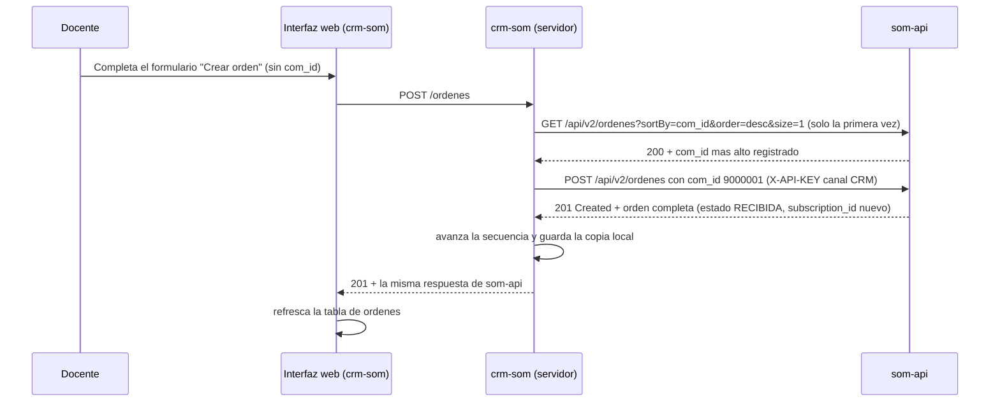
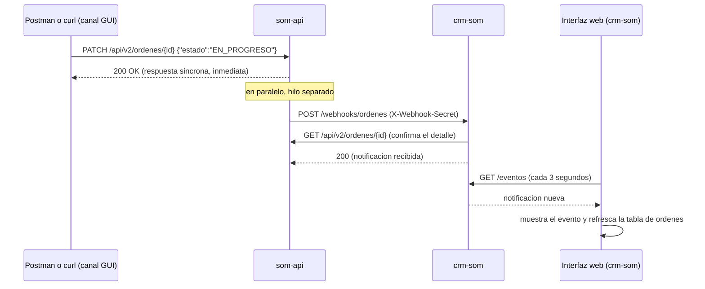

<div style="background-color:#307FE2; padding: 28px 36px; margin-bottom: 4px;">
  
</div>
<div style="background-color:#1A1A1A; padding: 4px 36px 20px 36px; margin-bottom: 28px;">
  <h1 style="font-family: Merriweather, Georgia, serif; color:#FFFFFF; margin: 12px 0 4px 0;">Guía de Integración — CRM y Orden de Servicio</h1>
  <p style="font-family: Lato, Calibri, sans-serif; color:#8BB8E8; margin: 0; font-size: 0.95em;">CUY6142 — Telepresencia y Entornos Innovadores de Colaboración Humana</p>
</div>

## 1. Información del Documento

| Campo | Valor |
| --- | --- |
| Documento | Guía de Integración — CRM (`crm-som`) y Orden de Servicio (`som-api`) |
| Versión | 2.0 |
| Fecha | 12/10/2026 |
| Preparado por | Pablo Moscoso |
| Curso | CUY6142 — Telepresencia y Entornos Innovadores de Colaboración Humana |
| Uso | Interno del docente: preparación y ejecución de la demostración en clase |
| Componentes | `som-api` 2.1 (imagen `moscosov/som-api-demo:v2.1`) y `crm-som` 2.0 (imagen `moscosov/crm-som-demo:v2.0`) |
| Documentos asociados | `Contrato_Operativo_OrdenServicio_DuocUC.md` (2.2), `Contrato_Datos_OrdenServicio_DuocUC.md` (2.1), `1_1_EspecificacionFuncional_OrdenServicio_DuocUC.md` (3.1), `Validacion_Local_OrdenServicio.md` |

### Gestión de Versiones

| Versión | Fecha | Preparado por | Sección y texto revisado |
| --- | --- | --- | --- |
| 1.0 | 28/09/2026 | Pablo Moscoso | Versión inicial, para estudiantes, sobre `crm-som` 1.x y la ruta `/api/v1` |
| 2.0 | 12/10/2026 | Pablo Moscoso | Cambio mayor. Pasa a uso docente: `crm-som` es una demostración que opera el docente. Alineada con `crm-som` 2.0 y la ruta `/api/v2`. Sección 4: cuatro tipos de orden, paginación y trazabilidad en el canal CRM. Sección 5 nueva: numeración de `com_id` en el rango reservado. Sección 9 nueva: registro periódico del webhook. Sección 10 nueva: despliegue de la demostración con el compose `som-crm` (reemplaza al MOP de Semana 8). Sección 11: guion de la demostración. Anexos nuevos: Troubleshooting, endpoints y códigos propios de `crm-som`, variables de entorno y glosario |

---

## 2. Propósito y Alcance

Esta guía explica al docente **cómo se integran `crm-som` y `som-api`**, cómo desplegar ambos servicios para la demostración y qué mostrar en clase. `crm-som` se usa como caja negra: los estudiantes ven la comunicación entre sistemas (petición síncrona y notificación asíncrona), no su implementación.

No repite lo que ya documentan otras fichas:

- Endpoints, autenticación, códigos de estado y el mecanismo de webhook de `som-api`: Contrato Operativo.
- Estructura de las órdenes, reglas de negocio y máquinas de estados: Contrato de Datos.
- Actores y casos de uso de negocio: Especificación Funcional.
- Pruebas locales de ambos servicios, con y sin Docker: `Validacion_Local_OrdenServicio.md`, Escenarios C y D.

Fuera de alcance: el ambiente de los estudiantes de la Actividad 2.4.2, que no incluye `crm-som`.

---

## 3. Los Dos Sistemas y Sus Roles

| Sistema | Rol | Analogía para la clase |
| --- | --- | --- |
| `som-api` | Fuente de verdad. El único lugar donde una orden existe, cambia de estado y queda registrada. Guarda sus datos en un volumen Docker. | La cocina de un restaurante: prepara el pedido y es la única que sabe con certeza en qué paso va. |
| `crm-som` | Sistema Cliente de referencia del canal CRM. Toma los pedidos, les asigna su número de orden comercial y recibe los avisos de `som-api`. Mantiene una copia local de las órdenes, pero no decide nada. | El mesero: anota el pedido con su número de comanda, lo lleva a la cocina y avisa cuando está listo, pero no cocina ni decide cuándo algo pasa a la etapa siguiente. |

Ninguna orden vive en `crm-som`. La tabla de órdenes de su interfaz se lee siempre desde `som-api`, y la copia local se reconstruye desde `som-api` cuando hace falta.

---

## 4. Canales y Operaciones

`som-api` distingue quién le habla por la credencial que recibe en `X-API-KEY` (Contrato Operativo, Sección 4). Esa credencial determina el **canal de origen**, `CRM` o `GUI`. `crm-som` usa siempre la clave fija del canal CRM.

| Operación | Método en `som-api` | Canal | Herramienta |
| --- | --- | --- | --- |
| Crear orden de cualquiera de los cuatro tipos | `POST /ordenes` | CRM | Interfaz de `crm-som` |
| Listar órdenes, con filtros y paginación | `GET /ordenes` | CRM | Interfaz de `crm-som` |
| Consultar una orden, con su oferta | `GET /ordenes/{id}` | CRM | Interfaz de `crm-som` (botón **Ver**) |
| Consultar la trazabilidad | `GET /ordenes/{id}/trazabilidad` | CRM | Interfaz de `crm-som` (botón **Trazabilidad**) |
| Editar prioridad y descripción | `PUT /ordenes/{id}` | CRM | Interfaz de `crm-som` (botón **Editar**) |
| Cancelar una orden | `DELETE /ordenes/{id}` | CRM | Interfaz de `crm-som` (botón **Cancelar**) |
| Consultar ofertas y suscripciones activas del cliente | `GET /ofertas`, `GET /suscripciones` | CRM | Interfaz de `crm-som` (listas del formulario) |
| **Transicionar el estado** | `PATCH /ordenes/{id}` | **GUI** | **Postman o `curl`, directo contra `som-api`** |

`crm-som` no usa `PATCH`. Es una decisión de diseño: el Sistema Cliente pide y sigue sus órdenes, pero no ejecuta el cumplimiento. Ese rol es del Actor de Soporte, que en la demostración representa el docente con Postman o `curl` (Especificación Funcional, Sección 3).

Los campos `cliente_id`, `tipo_servicio`, `offer_id` y `subscription_id` son inmutables en la versión 2.0 (Contrato de Datos, Sección 3.1): por eso el formulario de edición de `crm-som` solo muestra prioridad y descripción.

---

## 5. Numeración de Órdenes Comerciales (`com_id`)

En la versión 2.0, toda orden necesita un `com_id`: el número con que el sistema solicitante identifica su pedido. `crm-som` emite los suyos en el rango reservado `9000000` a `9999999` (Contrato de Datos, Sección 3.5); la interfaz no lo pide, y si una solicitud trae uno, `crm-som` lo descarta y usa el suyo.

Cómo obtiene el número, sin guardar estado propio:

1. En la primera creación después de arrancar, `crm-som` consulta el `com_id` más alto registrado en `som-api` (`GET /ordenes?sortBy=com_id&order=desc&size=1`).
2. Si ese número pertenece al rango reservado, continúa desde el siguiente. Si no, parte en `9000001`.
3. Cada creación usa el siguiente número. El número solo avanza cuando `som-api` acepta la orden: un rechazo por validación (`422`, `404` o `409` de negocio) no deja huecos en la secuencia.
4. Si `som-api` responde `409 COM_ID_DUPLICADO`, alguien usó ese número fuera de `crm-som`. `crm-som` vuelve a consultar el número más alto y reintenta, hasta tres veces.
5. Las creaciones simultáneas se atienden de a una, por lo que nunca dos órdenes reciben el mismo número.

Consecuencias que conviene saber antes de la clase:

- Si `crm-som` se reinicia, continúa la secuencia sin repetir números, porque la reconstruye desde `som-api`.
- Si se borra el volumen de datos de `som-api` (`docker compose down -v`), la secuencia vuelve a `9000001`.
- Los scripts `carga_masiva.py` y `som_relocation.py` generan `com_id` al azar entre `1000000` y `9999999`. Si se ejecutan contra el mismo `som-api` de la demostración, pueden crear números del rango reservado: la secuencia de `crm-som` salta hacia adelante, y un `9999999` agota el rango (Anexo 1, Problema 7).

---

## 6. Flujo de una Creación desde el CRM

Ejemplo: el docente crea un `ALTA` desde la interfaz de `crm-som`.



Puntos a destacar en clase:

- `crm-som` no valida el negocio: arma la solicitud, le agrega el `com_id` y la reenvía. La respuesta que se ve en la interfaz es la misma que devolvió `som-api`, errores incluidos.
- Toda la secuencia es **síncrona**: la interfaz espera hasta recibir la respuesta.
- El panel **Última operación** muestra lo que se envió y lo que se recibió, útil para mostrar el JSON de la orden.

---

## 7. Transición Manual con Postman o `curl`

Para que una orden avance de estado, el docente sale de la interfaz de `crm-som` y actúa directamente sobre `som-api` con el canal GUI. Puede usar el usuario `gui` (contraseña `Cuy6142!`) con `loginViaBasic`, o la clave fija del canal GUI, `DUOC-CUY6142-DEMO`.

Desde una terminal de su equipo, el docente define primero tres variables, para que los comandos quepan en una línea. Ejecuta estos tres comandos, uno a la vez:

```bash
SOM=http://<IP_DOCENTE>:8081/api/v2
```

> ⚠️ La IP de abajo es un EJEMPLO — reemplázala por la IP pública de tu instancia (Sección 10).
>
> ❌ Incorrecto: `SOM=http://<54.210.10.20>:8081/api/v2` (dejaste los símbolos < >)
> ❌ Incorrecto: `SOM=https://54.210.10.20:8081/api/v2` (el servicio usa `http`, no `https`)
> ✅ Correcto: `SOM=http://54.210.10.20:8081/api/v2` (la IP pública real, sin < >)

```bash
CLAVE='X-API-KEY: DUOC-CUY6142-DEMO'
```

```bash
ORDEN=<ID_ORDEN>
```

`<ID_ORDEN>` es el `id` (UUID) de la orden, no su `com_id`. Se obtiene con el botón **Ver** de la interfaz de `crm-som`.

Transición a `EN_PROGRESO`:

```bash
curl -X PATCH "$SOM/ordenes/$ORDEN" -H "$CLAVE" -H 'Content-Type: application/json' -d '{"estado":"EN_PROGRESO"}'
```

Respuesta esperada: `200`, con `"estado": "EN_PROGRESO"` y `"notificacion_webhook": "pendiente"`.

Transición a `COMPLETADA`:

```bash
curl -X PATCH "$SOM/ordenes/$ORDEN" -H "$CLAVE" -H 'Content-Type: application/json' -d '{"estado":"COMPLETADA"}'
```

Solo son válidas las transiciones de la máquina de estados (Contrato de Datos, Sección 5.1): `RECIBIDA` a `EN_PROGRESO`, `EN_PROGRESO` a `COMPLETADA`, y la cancelación desde cualquiera de esos dos estados. Cualquier otra responde `409 TRANSICION_INVALIDA`.

En Postman, la colección `Postman_Coleccion_OrdenServicio_DuocUC_v2.json` ya trae estas solicitudes.

---

## 8. Cierre del Ciclo: la Notificación

El `PATCH` de la sección anterior no termina la historia. Después de responder `200` a Postman, `som-api` avisa a `crm-som` en un hilo separado, sin que Postman lo espere:



Puntos a destacar en clase:

- Postman recibe su `200` **antes** de que la notificación salga: son dos comunicaciones desacopladas en el tiempo.
- `crm-som` valida el secreto compartido (`X-Webhook-Secret`) y confirma el detalle con un `GET`: no confía solo en lo que trae el aviso (Contrato Operativo, Sección 6.5).
- En la interfaz, la notificación aparece sola en **Notificaciones recibidas**, con su `com_id`, tipo de orden, suscripción, transición y canal de origen, y la tabla de órdenes se actualiza sin que nadie la recargue.
- Un `DELETE` hecho desde la propia interfaz de `crm-som` también genera una notificación, con canal de origen `CRM`: el aviso informa todo cambio de estado, sin importar quién lo hizo.

---

## 9. Registro Periódico del Webhook

`som-api` guarda el webhook registrado solo en memoria (Contrato Operativo, Sección 3): si se reinicia, deja de notificar sin avisar a nadie. Como no existe un endpoint para consultar qué webhook está registrado, `crm-som` repite su registro (`POST /webhooks`) cada 60 segundos, y en el mismo ciclo reconstruye su copia local de las órdenes desde `som-api`.

| Situación | Qué hace `crm-som` | Qué se ve |
| --- | --- | --- |
| Arranque | Se registra de inmediato; si `som-api` no responde, reintenta cada 5 segundos | Indicador **webhook registrado** en verde en el encabezado de la interfaz |
| `som-api` caído durante un ciclo | Marca el registro como perdido y reintenta cada 5 segundos | Indicador en rojo; línea `WEBHOOK_NO_REGISTRADO` en el log de `crm-som` |
| `som-api` vuelve | Se registra de nuevo y reconstruye la copia local | Indicador en verde; línea `WEBHOOK_RECUPERADO` en el log |
| `som-api` se reinicia entre dos ciclos | No lo detecta hasta el ciclo siguiente | Durante hasta 60 segundos, los cambios de estado no se notifican ni quedan en `GET /webhooks/fallos`. La tabla de órdenes sigue correcta, porque se lee desde `som-api` |

Consecuencias de diseño:

- **Desplaza a otros receptores.** `som-api` admite un único webhook (Contrato Operativo, Sección 6.2). Si alguien registra otro receptor en el mismo `som-api`, `crm-som` lo reemplaza en su ciclo siguiente. No se puede hacer la demostración del webhook con un receptor propio sobre el mismo `som-api` mientras `crm-som` está corriendo.
- **Registro en el log de `som-api`.** Cada ciclo agrega una línea `POST /api/v2/webhooks` y una o más `GET /api/v2/ordenes` con `canal=CRM`. Es esperable; el intervalo se cambia con `WEBHOOK_REREGISTRO_SEGUNDOS` (Anexo 3).
- **Recuperación inmediata.** Para no esperar el ciclo, basta reiniciar `crm-som`: se registra al arrancar.

---

## 10. Despliegue de la Demostración

La demostración corre en una instancia EC2 del docente, con el compose `docker-compose/som-crm` del repositorio del curso. Las imágenes se descargan desde Docker Hub; no se construye nada en la instancia.

### Parte A — Instancia

#### Paso 1 — Lanzar la instancia

**EC2 → Instancias → Lanzar instancias**:

- **Nombre:** `som-crm-demo`.
- **AMI:** Ubuntu Server 24.04 LTS (HVM), SSD Volume Type, 64 bits (x86).
- **Tipo de instancia:** `t3.small`. Ambos servicios son procesos Flask livianos.
- **Par de claves:** `vockey`.
- **Firewall:** grupo de seguridad nuevo con tres reglas de entrada: SSH (TCP `22`), TCP personalizado `8081` (`som-api`) y TCP personalizado `8082` (`crm-som`), todas con origen `0.0.0.0/0`.
- **Almacenamiento:** 20 GiB, tipo **gp2**.

Haz clic en **Lanzar instancia** y anota su **Dirección IPv4 pública**: es `<IP_DOCENTE>` en el resto de esta guía.

#### Paso 2 — Conectarse con PuTTY

En **Session → Host Name**, escribe lo siguiente. Puerto: `22`. En **Connection → SSH → Auth → Credentials**, elige `labsuser.ppk`.

```text
ubuntu<IP_DOCENTE>
```

#### Paso 3 — Instalar Docker

Descarga y ejecuta el instalador oficial de Docker:

```bash
curl -fsSL https://get.docker.com | sudo sh
```

Agrega el usuario `ubuntu` al grupo `docker`, para no usar `sudo` en cada comando:

```bash
sudo usermod -aG docker ubuntu
```

Cierra la sesión y vuelve a conectarte con PuTTY (Paso 2), para que el cambio de grupo se aplique:

```bash
exit
```

👉 [Pincha acá si algo te falló en este paso (Anexo 1)](#problema-1)

#### Paso 4 — Clonar el repositorio del curso

Ve a tu carpeta personal:

```bash
cd ~
```

Descarga la rama `desarrollo`, que trae el compose `som-crm` (cuando se integre a `master`, se omite `-b desarrollo`):

```bash
git clone -b desarrollo https://github.com/moscosov/som-api-demo.git
```

### Parte B — Levantar los servicios

#### Paso 5 — Entrar a la carpeta del compose

```bash
cd ~/som-api-demo/docker-compose/som-crm
```

#### Paso 6 — Levantar `som-api` y `crm-som`

```bash
docker compose up -d
```

Docker descarga las dos imágenes (solo la primera vez), crea la red `som-network` y el volumen de datos, y arranca `som-api`. `crm-som` arranca recién cuando `som-api` está sano (`depends_on` con `condition: service_healthy`). Si el error menciona la descarga de la imagen de `crm-som`, ver el Problema 3.

👉 [Pincha acá si algo te falló en este paso (Anexo 1)](#problema-2)

### Parte C — Pruebas de Servicio

#### Paso 7 — Verificar que ambos servicios están sanos

```bash
docker compose ps
```

Resultado esperado: `som-api` y `crm-som` con estado `Up ... (healthy)`. Si indica `(health: starting)`, espera 30 segundos y repite.

#### Paso 8 — Verificar el registro del webhook

```bash
docker compose logs crm-som
```

Resultado esperado, entre otras líneas:

```text
WEBHOOK_REGISTRADO | url=http://crm-som:8082/webhooks/ordenes reregistro cada 60 s
```

👉 [Pincha acá si algo te falló en este paso (Anexo 1)](#problema-4)

#### Paso 9 — Abrir las dos interfaces desde el navegador del equipo del docente

Interfaz de `crm-som`:

```text
http://<IP_DOCENTE>:8082/
```

Documentación de `som-api` (Swagger UI):

```text
http://<IP_DOCENTE>:8081/api/v2/docs
```

En la interfaz de `crm-som`, el encabezado debe mostrar `som-api en http://som-api:8081/api/v2` y el indicador **webhook registrado** en verde.

👉 [Pincha acá si algo te falló en este paso (Anexo 1)](#problema-9)

### Parte D — Detener y retomar

Los datos de `som-api` viven en el volumen `som-crm_som-data` y sobreviven a `down` y `up`. El webhook y la copia local de `crm-som` se reconstruyen solos al arrancar.

Detener los servicios conservando los datos:

```bash
docker compose down
```

Retomar después de reiniciar el laboratorio (la IP pública cambia: actualiza `<IP_DOCENTE>`):

```bash
docker compose up -d
```

Borrar los datos y partir de cero (la secuencia de `com_id` vuelve a `9000001`):

```bash
docker compose down -v
```

> ⚠️ El compose `som-crm` no puede correr al mismo tiempo que el compose `docker-compose/som-api` en la misma instancia: ambos usan el contenedor `som-api` y el puerto `8081`. Además, cada uno tiene su propio volumen de datos: las órdenes creadas en uno no aparecen en el otro.

---

## 11. Guion de la Demostración

Orden sugerido para mostrar en clase la comunicación síncrona y asíncrona entre sistemas. Requiere la Sección 10 completa y las tres variables de la Sección 7 definidas en una terminal del equipo del docente.

**1. Contratación (síncrona, canal CRM).** En la interfaz de `crm-som`, **Crear orden**: tipo `ALTA`, cliente `CL-10457`, servicio `INTERNET`, oferta `200102 - Fibra 600 Mbps`. Mostrar en **Última operación** que la solicitud enviada no traía `com_id` y que la respuesta trae `9000001`, la suscripción `20000001` y el estado `RECIBIDA`.

**2. Cumplimiento (síncrono por GUI, asíncrono hacia el CRM).** Copiar el `id` con **Ver**, asignarlo a `ORDEN` y ejecutar el `PATCH` a `EN_PROGRESO` de la Sección 7. Mostrar que la terminal recibe `200` de inmediato y que, segundos después, la notificación aparece sola en la interfaz y la tabla cambia a `EN_PROGRESO`. Repetir con `COMPLETADA`.

**3. Efecto sobre la suscripción.** En **Crear orden**, elegir tipo `RELOCALIZACION`: la lista de suscripciones ya muestra la `20000001` como `ACTIVA`, porque el `ALTA` se completó.

**4. Relocalización y trazabilidad.** Crear la `RELOCALIZACION` con punto actual `x 2.5`, `y 1.75`, referencia `Living`, y destino `x 6.125`, `y 4.5`, referencia `Dormitorio 2`. Abrir **Trazabilidad**: 6,375 m de cable, 00:37:45 de duración y cuatro pasos. Cambiar el idioma para mostrar los textos en inglés.

**5. Cancelación desde el CRM.** **Cancelar** la relocalización. Mostrar que llega una notificación con operación `DELETE` y canal de origen `CRM`: el aviso informa todo cambio de estado, incluso los que hizo el propio CRM.

**6. Fallo de entrega y conciliación.** Crear desde la interfaz un `ALTA` nuevo y asignar su `id` a `ORDEN` (Sección 7). Luego, en la instancia, detener `crm-som`:

```bash
docker compose stop crm-som
```

Transicionar esa orden a `EN_PROGRESO` con el `PATCH` de la Sección 7. La respuesta sigue siendo `200`: `som-api` no depende de que el receptor esté disponible. Consultar el registro de fallos:

```bash
curl "$SOM/webhooks/fallos" -H "$CLAVE"
```

Debe aparecer una entrada para esa orden, con el motivo del fallo. Volver a levantar `crm-som`:

```bash
docker compose start crm-som
```

Mostrar que `crm-som` se vuelve a registrar al arrancar y que su tabla muestra el estado correcto, leído desde `som-api`. Ese es el rol de la conciliación (Contrato Operativo, Sección 6.7): la notificación perdida no se reenvía, pero el estado real siempre se puede consultar.

**7. Reinicio de `som-api` (opcional).** Reiniciar `som-api`:

```bash
docker compose restart som-api
```

Mostrar que las órdenes siguen ahí (volumen de datos) y que el indicador del webhook puede pasar a rojo y volver a verde en el ciclo siguiente (Sección 9).

---

## 12. Resumen — Quién Hace Qué

| Momento del flujo | Canal | Herramienta | Tipo de comunicación |
| --- | --- | --- | --- |
| Crear, ver, editar o cancelar una orden; consultar su trazabilidad | CRM | Interfaz web de `crm-som` | Síncrona |
| Asignar el `com_id` | — | `crm-som`, automáticamente | Interna de `crm-som` |
| Transicionar el estado de una orden | GUI | Postman o `curl`, directo a `som-api` | Síncrona (la respuesta al `PATCH`) |
| Avisar que el estado cambió | — (lo origina `som-api`) | Ninguna: llega sola | Asíncrona (webhook) |
| Mantener el registro del webhook | CRM | `crm-som`, cada 60 segundos | Síncrona, periódica |

---

## 13. Referencias

| Documento | Qué encontrar ahí |
| --- | --- |
| `Contrato_Operativo_OrdenServicio_DuocUC.md` (2.2) | Autenticación por canal, endpoints, códigos de estado, webhook (Sección 6) y registro único (Sección 6.2) |
| `Contrato_Datos_OrdenServicio_DuocUC.md` (2.1) | Estructura de las órdenes, máquinas de estados y rangos de `com_id` (Sección 3.5) |
| `1_1_EspecificacionFuncional_OrdenServicio_DuocUC.md` (3.1) | Actores (Sistema Cliente, Actor de Soporte) y casos de uso |
| `GuiaRapida_OrdenServicio_DuocUC.md` | Comandos de `som-api` listos para copiar |
| `Validacion_Local_OrdenServicio.md` | Escenario C (`crm-som` sin Docker) y Escenario D (compose `som-crm`) |
| `crm/crm_som.py`, `crm/Dockerfile`, `docker-compose/som-crm/docker-compose.yml` | Implementación, imagen y despliegue de `crm-som` 2.0, en el repositorio del curso |

---

## Anexo 1 — Troubleshooting

### Problema 1

**`permission denied while trying to connect to the Docker daemon socket` al ejecutar `docker` sin `sudo`**

La sesión de PuTTY es anterior al cambio de grupo del Paso 3. Cierra la sesión, vuelve a conectarte y comprueba que el grupo `docker` aparece en la lista:

```bash
groups
```

### Problema 2

**`docker compose up -d` falla con `Conflict. The container name "/som-api" is already in use` o con `port is already allocated`**

Está corriendo el compose `docker-compose/som-api` en la misma instancia. Ve a su carpeta:

```bash
cd ~/som-api-demo/docker-compose/som-api
```

Detenlo (sus datos se conservan en su propio volumen):

```bash
docker compose down
```

Vuelve a la carpeta `som-crm` y repite el Paso 6.

### Problema 3

**`docker compose up -d` falla con `pull access denied` o `manifest unknown` para `moscosov/crm-som-demo:v2.0`**

La imagen todavía no está publicada en Docker Hub. Constrúyela en la instancia, desde la carpeta del repositorio:

```bash
docker build -t moscosov/crm-som-demo:v2.0 ~/som-api-demo/crm
```

Luego repite el Paso 6.

### Problema 4

**El indicador muestra webhook "no registrado" (rojo), o el log de `crm-som` muestra `WEBHOOK_NO_REGISTRADO`**

Revisa el motivo en el estado de `crm-som`, campo `webhook.ultimo_error`:

```bash
curl http://localhost:8082/estado
```

- `som-api inalcanzable`: `som-api` está detenido o arrancando. Revisa con `docker compose ps`; `crm-som` se registra solo cuando vuelve.
- `som-api respondio 401 (NO_AUTORIZADO)`: la variable `SOM_API_KEY` del compose no es la clave del canal CRM (`DUOC-CUY6142-DEMO-CRM`).

### Problema 5

**Crear una orden responde `502` con código `SOM_API_INALCANZABLE`**

`crm-som` no logra contactar a `som-api`. Revisa el estado de ambos:

```bash
docker compose ps
```

Si `som-api` no está `Up`, revisa su registro:

```bash
docker compose logs som-api
```

### Problema 6

**Crear una orden responde `502` con código `COM_ID_NO_SINCRONIZADO`**

`som-api` rechazó la consulta del `com_id` más alto, casi siempre por la clave: mismo diagnóstico del Problema 4.

### Problema 7

**Crear una orden responde `503` con código `RANGO_COM_ID_AGOTADO`**

Existe en `som-api` una orden con `com_id` `9999999`, creada fuera de `crm-som` (por ejemplo, por `carga_masiva.py` o `som_relocation.py`, que generan números al azar hasta `9999999`). `som-api` no elimina órdenes, así que la única forma de recuperar el rango es partir de cero, lo que **borra todas las órdenes** de la demostración:

```bash
docker compose down -v
```

```bash
docker compose up -d
```

Para evitarlo, no ejecutar esos scripts contra el `som-api` de la demostración.

### Problema 8

**Un `PATCH` responde `200` con `notificacion_webhook: pendiente`, pero la notificación no aparece en la interfaz**

Hay tres causas posibles:

- `som-api` se reinició hace menos de 60 segundos y `crm-som` todavía no repite su registro (Sección 9). Reinicia `crm-som` para que se registre de inmediato:

```bash
docker compose restart crm-som
```

- Alguien registró otro receptor en `som-api`. Lo reemplaza el ciclo siguiente de `crm-som`, o el reinicio de arriba.
- La entrega falló. Consulta el registro de fallos (Sección 11, punto 6):

```bash
curl "$SOM/webhooks/fallos" -H "$CLAVE"
```

### Problema 9

**El navegador no abre `http://<IP_DOCENTE>:8082/` (tiempo de espera agotado)**

Falta la regla de entrada TCP `8082` (o `8081` para Swagger UI) en el grupo de seguridad de la instancia (Paso 1), o la IP cambió al reiniciar el laboratorio. Desde la propia instancia, comprueba que `crm-som` responde:

```bash
curl http://localhost:8082/estado
```

Si responde, el problema está en el grupo de seguridad o en la IP, no en el servicio.

---

## Anexo 2 — Endpoints y Códigos Propios de `crm-som`

### A. Endpoints

`crm-som` expone su propia API en el puerto `8082`. Las rutas de órdenes, suscripciones y ofertas son un proxy hacia `som-api`: reenvían los parámetros de consulta y devuelven la respuesta de `som-api` tal cual, incluido el header `X-Total-Count`.

| Método | Ruta | Acción |
| --- | --- | --- |
| GET | `/` | Interfaz web |
| GET | `/estado` | Estado del servicio (JSON): versión, URL de `som-api`, registro del webhook, rango y siguiente `com_id`, órdenes en la copia local y notificaciones recibidas |
| POST | `/ordenes` | Crear orden; `crm-som` asigna el `com_id` |
| GET | `/ordenes` | Listar órdenes (proxy) |
| GET | `/ordenes/{id}` | Consultar una orden (proxy) |
| PUT | `/ordenes/{id}` | Reemplazar prioridad y descripción (proxy) |
| DELETE | `/ordenes/{id}` | Cancelar una orden (proxy) |
| GET | `/ordenes/{id}/trazabilidad` | Consultar la trazabilidad (proxy) |
| GET | `/suscripciones` | Listar suscripciones (proxy) |
| GET | `/ofertas` | Listar ofertas (proxy) |
| GET | `/eventos` | Notificaciones recibidas (las últimas 200) y total recibido |
| POST | `/webhooks/ordenes` | Receptor del webhook de `som-api` |

### B. Códigos de error propios

Usan el mismo formato de error de `som-api` (Contrato Operativo, Sección 7). Cualquier otro error que muestre la interfaz viene de `som-api` y se interpreta con el Contrato Operativo, Sección 8.

| HTTP | `codigo` | Cuándo se produce |
| --- | --- | --- |
| `400` | `JSON_INVALIDO` | El cuerpo de una creación, de un reemplazo o de una notificación no es un objeto JSON |
| `401` | `WEBHOOK_SECRET_INVALIDO` | Una notificación llegó sin `X-Webhook-Secret` o con un valor distinto del configurado |
| `502` | `SOM_API_INALCANZABLE` | `som-api` no respondió dentro de 5 segundos o rechazó la conexión |
| `502` | `COM_ID_NO_SINCRONIZADO` | `som-api` rechazó la consulta del `com_id` más alto |
| `503` | `RANGO_COM_ID_AGOTADO` | El siguiente `com_id` supera `9999999` |

---

## Anexo 3 — Variables de Entorno de `crm-som`

El compose `som-crm` declara explícitamente las cinco primeras, con los mismos valores por defecto de la imagen, para que se vean y se puedan cambiar sin reconstruirla.

| Variable | Valor por defecto | Uso |
| --- | --- | --- |
| `SOM_API_URL` | `http://som-api:8081/api/v2` | URL base de `som-api`. Fuera de Docker: `http://localhost:8081/api/v2` |
| `SOM_API_KEY` | `DUOC-CUY6142-DEMO-CRM` | Clave fija del canal CRM |
| `WEBHOOK_SECRET` | `DUOC-CUY6142-DEMO-WEBHOOK-SECRET` | Secreto esperado en `X-Webhook-Secret`; debe coincidir con el de `som-api` |
| `WEBHOOK_URL_PROPIA` | `http://crm-som:8082/webhooks/ordenes` | URL con que `crm-som` se registra. Debe ser alcanzable **desde `som-api`**. Fuera de Docker: `http://localhost:8082/webhooks/ordenes` |
| `WEBHOOK_REREGISTRO_SEGUNDOS` | `60` | Intervalo del registro periódico del webhook |
| `WEBHOOK_REINTENTO_SEGUNDOS` | `5` | Espera antes de reintentar un registro fallido |
| `PORT` | `8082` | Puerto de escucha de `crm-som` |

En Kubernetes, la clave y el secreto van en un Secret y las URL en un ConfigMap. `WEBHOOK_URL_PROPIA` cambia según la topología: `http://localhost:8082/webhooks/ordenes` si `crm-som` corre en el mismo pod que `som-api`, o el nombre de su Service si corre en otro pod.

---

## Anexo 4 — Glosario

| Término | Definición |
| --- | --- |
| Proxy | Servicio intermedio que recibe una solicitud y la reenvía a otro servicio, devolviendo su respuesta. `crm-som` es un proxy hacia `som-api` para las órdenes, suscripciones y ofertas. |
| Copia local (caché) | Datos que `crm-som` guarda en memoria para su propio uso; `som-api` sigue siendo la fuente de verdad. |
| Rango reservado de `com_id` | Números de orden comercial que solo emite `crm-som` (`9000000` a `9999999`), por convención entre sistemas solicitantes. |
| Registro periódico | Repetición del registro del webhook a intervalos fijos, para recuperarse de un reinicio de `som-api`. |
| Conciliación | Comparación del estado local de un receptor contra el estado real de `som-api`, para detectar avisos que no llegaron. |
| Healthcheck | Comando que Docker ejecuta periódicamente dentro de un contenedor para saber si el servicio responde; su resultado es el estado `healthy` de `docker compose ps`. |

---

*Documento de uso docente — complementa el Contrato Operativo (protocolo de `som-api`) y la Validación Local (pruebas), sin repetir su contenido. Se actualiza si cambia el diseño de canales, la numeración de `com_id`, el mecanismo de notificación o el despliegue de la demostración.*
